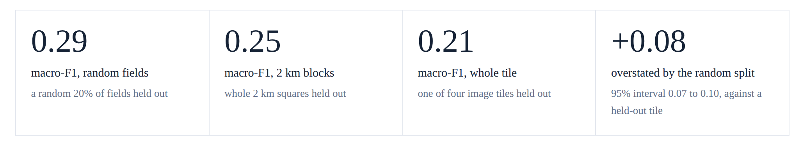
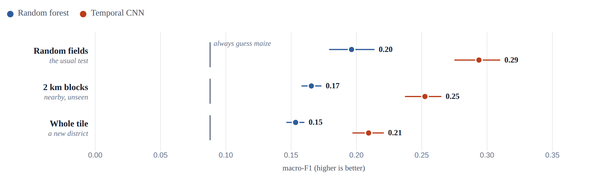
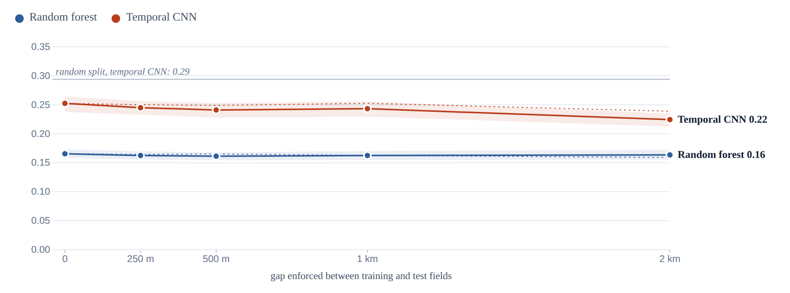
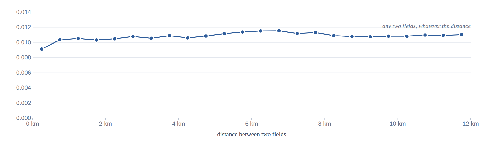
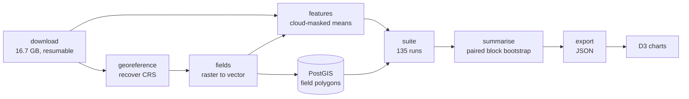
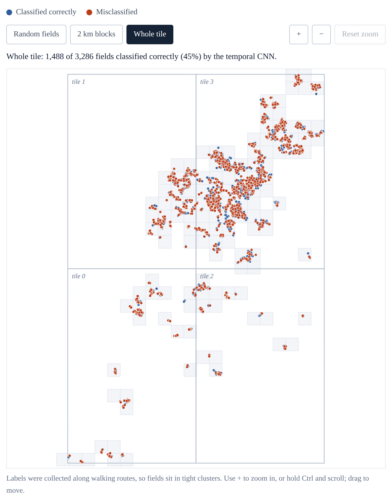

# How much does a random split overstate crop-type mapping accuracy?

A spatial-validation study of smallholder crop-type classification from Sentinel-2 time
series in Busia County, western Kenya, run against a plan written before the full experiment.

**Interactive write-up:** [iam-amos.io/work/crop-map-spatial-validation](https://iam-amos.io/work/crop-map-spatial-validation/)



**The short answer.** On 3,286 labelled fields, the better of two models scores a macro-F1
of **0.29** when tested on a random sample of fields, **0.25** when whole 2 km blocks are
held out, and **0.21** when a whole image tile is held out. The random split overstates
performance in a new area by **0.08 macro-F1 (95% interval 0.065 to 0.100)**, more than a
quarter of the headline score. Overall accuracy hides this: it moves by less than two
points, while recall on the rarest crop falls from 15% to under 1%.

Scores are low in absolute terms. Seven classes, four of them intercrops, on fields with
a median size of ten pixels is a hard problem, and this study does not solve it. Its
subject is the difference between the columns.

## Contents

- [The question](#the-question)
- [Results](#results)
- [What held and what did not](#what-held-and-what-did-not)
- [The dataset had no coordinates](#the-dataset-had-no-coordinates)
- [Pipeline](#pipeline)
- [PostGIS](#postgis)
- [Interactive charts (D3)](#interactive-charts-d3)
- [Reproduce it](#reproduce-it)
- [Limits](#limits)
- [Data and credits](#data-and-credits)

## The question

A crop map is used where nobody collected labels. It is usually scored by holding out a
random sample of labelled fields. But labels are collected along walking routes, so a
held-out field almost always has labelled neighbours a few dozen metres away, sharing
its soil, weather and planting date. The random-split score then describes filling in
between labelled fields, which is an easier job than mapping a new place.

This study measures that difference with the same models and data, changing only which
fields are held out:

| Split | What is held out | What the score means |
|-------|------------------|----------------------|
| `random` | a random 20% of fields | accuracy next door to a labelled field |
| `block` | whole 2 km squares | accuracy a few kilometres from any label |
| `tile` | one of the four image tiles | accuracy in a district with no local labels |

The hypotheses, splits, metrics and uncertainty method were written down in
[VALIDATION_PLAN.md](VALIDATION_PLAN.md) before the first full run, and every change
made afterwards is logged at the bottom of that file. The plan was not lodged with an
outside registry, and it is committed alongside the results, so its priority rests on
that log and on my word.

## Results



Macro-F1, mean of five seeds, with 95% intervals from a bootstrap over 2 km blocks:

| Test design | Majority class | Random forest | Temporal CNN |
|-------------|---------------:|--------------:|-------------:|
| Random fields | 0.088 | 0.196 (0.179 to 0.213) | **0.294** (0.275 to 0.310) |
| 2 km blocks | 0.088 | 0.165 (0.158 to 0.173) | **0.252** (0.238 to 0.265) |
| Whole tile | 0.088 | 0.153 (0.147 to 0.160) | **0.209** (0.197 to 0.221) |

How much the random split overstates, as a paired difference on the same resamples:

| Model | Random minus block | Random minus tile |
|-------|-------------------:|------------------:|
| Random forest | 0.031 (0.014 to 0.048) | 0.043 (0.026 to 0.061) |
| Temporal CNN | 0.041 (0.023 to 0.060) | 0.084 (0.065 to 0.100) |

Every one of the 1,000 resamples gives a positive gap, for both models and both comparisons.

**Accuracy does not show the problem.** The temporal CNN's overall accuracy is 46%, 44%
and 44% across the three designs, close to the 44.5% from always answering maize. The
loss is in the minority crops:

| Crop (fields) | Recall, random | Recall, block | Recall, tile |
|---------------|---------------:|--------------:|-------------:|
| Maize (1,462) | 50% | 50% | 58% |
| Cassava (829) | 61% | 61% | 59% |
| Maize + common bean (487) | 38% | 30% | 17% |
| Maize + cassava (172) | 19% | 10% | 8% |
| Maize + soybean (160) | 13% | 7% | 7% |
| Common bean (98) | 15% | 9% | 0.4% |
| Cassava + common bean (78) | 15% | 11% | 1% |

Away from its training area, the model falls back on the two dominant crops.

## What held and what did not

| | Hypothesis | Outcome |
|--|-----------|---------|
| H1 | Random > block > tile | **Supported** for both models. |
| H2 | The gap grows with the distance between training and test fields, then levels off | **Not supported.** See below. |
| H3 | The neural model loses more than the forest | **Supported.** Its random-to-tile gap is larger by 0.041 (0.021 to 0.059). It is still the better model under every design. |
| H4 | Confidence is less trustworthy off-site | **Mixed.** Calibration error rises for the temporal CNN (0.057, 0.071, 0.093) and falls for the forest (0.066, 0.054, 0.030). |

### H2: distance beyond the block edge costs almost nothing



Dropping training fields within 250 m, 500 m, 1 km and 2 km of any test field also
shrinks the training set, from 2,629 fields to 1,202. So each buffered run has a control
trained on the same number of fields, chosen at random, with no gap. The paired
difference between control and buffered run is the cost of the gap itself:

| Gap | Random forest | Temporal CNN |
|-----|--------------:|-------------:|
| 250 m | 0.002 (0.000 to 0.005) | 0.005 (-0.004 to 0.014) |
| 500 m | 0.004 (0.000 to 0.009) | 0.008 (-0.001 to 0.017) |
| 1 km | 0.000 (-0.004 to 0.004) | 0.009 (-0.003 to 0.023) |
| 2 km | -0.004 (-0.010 to 0.000) | 0.014 (0.003 to 0.025) |

The leak in a random split is therefore very local. Two independent measurements agree:

- **Semivariogram.** Peak-season NDVI of fields 250 m apart shows 79% of the overall
  variance; by 750 m it is at 90%. Most likeness between fields is gone within a few
  hundred metres. 
- **Nearest neighbours (PostGIS).** The median distance from a labelled field to its
  nearest labelled neighbour is 60 m, and 38.5% of fields grow the same crop as that
  neighbour, against 29.0% expected by chance.

Holding out a 2 km block already removes those neighbours, which is why a further gap
adds little. The larger drop from block to tile is a change of place, not of distance.

### Robustness

- **Block size.** Random forest macro-F1 is 0.168, 0.165 and 0.165 for 1, 2 and 5 km blocks.
- **Field size.** Scoring the same predictions on larger fields only, the random-minus-block
  gap is 0.031 for all fields, 0.019 (0.007 to 0.032) for fields of at least 4 pixels and
  0.022 (0.006 to 0.039) for at least 9. Tiny fields do not explain the gap.
- **Per tile.** With a tile held out, the temporal CNN scores 0.21, 0.21, 0.27 and 0.20 on
  tiles 0 to 3. Tile 3 holds two thirds of all labels, so holding it out also leaves the
  smallest training set.

## The dataset had no coordinates

The rasters are published with no CRS and no geotransform, so no spatial analysis is
possible as shipped. [`georef.py`](src/cropval/georef.py) restores them from two
measurements, both reproducible with `cropval georeference`:

1. **The four tiles are one mosaic.** Edge rows and columns of neighbouring tiles
   correlate at 0.97 to 0.99, against 0.90 for adjacent columns inside a tile:

   ```
   tile 1 | tile 3
   -------+-------
   tile 0 | tile 2
   ```

2. **Tile 3 overlaps a georeferenced sibling dataset**
   ([african-crops-kenya-01](https://source.coop/radiantearth/african-crops-kenya-01),
   EPSG:32636). For the same date and band, a 400 x 400 pixel chip from each of its three
   tiles matches tile 3 with a normalised cross-correlation of 1.000 at a single offset.

The three matches agree on tile 3's corner to within 2.6 m east-west and 0.7 m
north-south, under a third of a pixel. The recovered field centroids average 34.2 E,
0.5 N: Busia County, as the dataset documentation says.

## Pipeline



| Step | Module | What it does |
|------|--------|--------------|
| `download` | `download.py` | Lists the public bucket and fetches it over HTTPS, with retries |
| `georeference` | `georef.py` | Re-derives the mosaic layout and the map origin |
| `fields` | `fields.py` | Raster to vector: one polygon per field with label, area and centroid |
| `postgis` | `postgis.py`, `sql/` | Loads the polygons; block assignment, buffer exclusion, neighbours |
| `features` | `features.py` | Cloud-masked mean of 12 bands per field and date, plus NDVI, NDRE, NDWI |
| `suite` | `suite.py`, `splits.py`, `models.py` | Runs the matrix, stores every out-of-fold prediction, summarises |
| `export` | `export.py`, `checks.py` | Writes the JSON behind the charts, including the semivariogram |

**Models.** A random forest on the flattened series (16 features x 13 dates), and a
three-layer temporal convolutional network in PyTorch. Both train on a laptop CPU; the
full matrix of 135 runs takes about an hour.

**No leakage by construction.** Cloud gaps are interpolated inside each field's own
series. Values a field never observed are imputed from training rows inside each fold.
Standardisation uses training rows only. Pixels are never split across train and test.

**Uncertainty.** One set of 1,000 resamples of 2 km blocks is shared by every statistic,
so differences are paired. Resampling blocks, not fields, keeps neighbouring errors
together. Each draw scores the mean over five seeds.

## PostGIS

Field polygons are stored in PostGIS in EPSG:32636. The two operations that define the
spatial splits are written twice, in NumPy and in SQL, and
[`tests/test_postgis.py`](tests/test_postgis.py) checks they return the same answer.

```sql
-- Training fields within a buffer of any test field (sql/buffer.sql)
SELECT DISTINCT tr.tile, tr.field_id
FROM fields tr
JOIN fields te ON ST_DWithin(tr.centroid, te.centroid, %(buffer_m)s)
WHERE ...
```

```sql
-- Does a field's nearest labelled neighbour grow the same crop? (sql/neighbours.sql)
SELECT f.label, n.label, ST_Distance(f.centroid, n.centroid)
FROM fields f
CROSS JOIN LATERAL (
    SELECT g.label, g.centroid FROM fields g
    WHERE g.label > 0 AND (g.tile, g.field_id) <> (f.tile, f.field_id)
    ORDER BY g.centroid <-> f.centroid LIMIT 1
) n
WHERE f.label > 0;
```

```sh
docker compose up -d
uv run cropval postgis load         # 4,688 fields
uv run cropval postgis neighbours   # label agreement with the nearest neighbour
uv run cropval postgis blocks       # 131 blocks; median 18 fields, largest 129
```

## Interactive charts (D3)

[`docs/`](docs/) is a static page drawn with D3 v7, with no build step: the split
comparison, the buffer curve with its controls, a zoomable map of every labelled field
coloured by whether it was classified correctly under each test design, the
semivariogram, and the results as a table.



```sh
python3 -m http.server 8090 --directory docs    # then open http://localhost:8090
```

The two series colours were checked for colour-vision-deficiency separation and
contrast in light and dark themes. Every chart has a hover read-out and the page
includes the numbers as a table.

## Reproduce it

Requires [uv](https://docs.astral.sh/uv/), Docker for PostGIS, about 20 GB of disk.

```sh
uv sync --extra dev
docker compose up -d
uv run pytest                 # 14 tests; the 3 PostGIS tests skip if no database is up

uv run cropval download       # 16.7 GB; --tiles 0 --dates 20190606 for a sample
uv run cropval georeference   # reproduce the coordinate recovery
uv run cropval fields         # 4,688 polygons, 3,286 labelled
uv run cropval features       # 60,944 field-date rows
uv run cropval checks         # cloud cover per date and tile
uv run cropval postgis load
uv run cropval suite          # 135 runs, about an hour on 8 cores; resumable
uv run cropval export         # writes docs/data/*.json
```

Seeds are fixed, so the tables above should reproduce to the third decimal on the same
library versions (`uv.lock`).

```
src/cropval/   download, georef, fields, features, splits, models, suite, export, postgis, cli
sql/           schema, blocks, buffer, neighbours, block_summary
tests/         11 pipeline tests on a synthetic tile, 3 PostGIS agreement tests
docs/          D3 page, chart code, exported data, figures
results/       run outputs (git-ignored)
```

## Limits

- **The plan is self-attested.** It was written before the full run but not registered
  anywhere, and nine amendments followed a code review. The plan named random minus block
  as its headline comparison; the larger random-minus-tile gap is reported beside it.
- **One region, one season.** Busia County, June to November 2019. Nothing here says how
  large the gap is elsewhere.
- **A weak classifier.** Neither model is tuned, and both are far from useful accuracy on
  the minority crops. A stronger model could show a different gap.
- **Four tiles.** The tile design has only four held-out units, and tile 3 holds two
  thirds of the labels. Its block-bootstrap interval is conditional on the four fitted
  models and understates what a fifth tile might show.
- **Class mix differs by area.** Part of the tile drop is a change in which crops are
  grown, not only in how they look. The per-class table separates the two only partly.
- **Small fields.** The median labelled field is 10 pixels; 15% are under 4.
- **Public training labels only.** The competition's held-out test labels are not published.
- **Recovered coordinates** are accurate to a few metres, not surveyed.

## Data and credits

Data: [CV4A Kenya Crop Type Competition](https://source.coop/radiantearth/african-crops-kenya-02),
PlantVillage and Radiant Earth Foundation, ICLR 2020 CV4A workshop
(doi:10.34911/rdnt.dw605x). Ground labels were collected with the PlantVillage app. No
data is redistributed in this repository; check the dataset's licence before reusing
anything derived from it.

Built with PyTorch, scikit-learn, rasterio, GeoPandas, PostGIS and D3.

Author: Amos Bunde, Nairobi.
